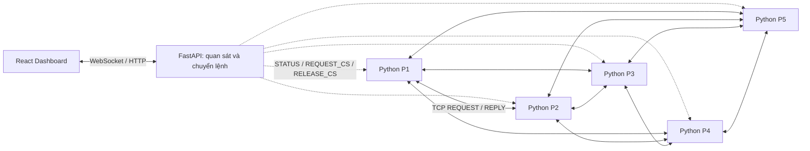

# Ricart & Agrawala Distributed Mutual Exclusion Simulator

Ứng dụng thực hành **loại trừ tương hỗ phân tán** cho môn Hệ thống phân tán. Năm tiến trình Python độc lập trao đổi REQUEST / REPLY qua TCP, tự quản lý đồng hồ Lamport và tự quyết định quyền vào vùng tới hạn. Dashboard tiếng Việt hiển thị sự kiện thật từ các node.

**Backend chỉ khởi động, giám sát và chuyển lệnh người dùng. Không có bộ điều phối khóa tập trung.**

## Công nghệ và chức năng

- Python 3.11+, FastAPI, Uvicorn, asyncio streams, Pydantic; pytest và pytest-asyncio.
- React 19, TypeScript, Vite 6, Tailwind CSS 4, SVG để biểu diễn đồ thị; WebSocket.
- Ba trạng thái RELEASED / WANTED / HELD; ưu tiên `(request_timestamp, process_id)`.
- Đối chiếu request ID, đếm mỗi peer một lần; REPLY hoãn được gửi khi rời HELD.
- Chế độ tự động (mặc định 3 giây) và thủ công; yêu cầu đồng thời P1/P2 hoặc tất cả node.
- Đồ thị thông điệp, bảng Lamport, timeline có bộ lọc, xuất JSONL, giải thích thuật toán và hướng dẫn demo.
- Cấu hình LAN cố định, node quản lý bên ngoài; không cần tài khoản, database hay dịch vụ trả phí.
- Chạy offline sau khi cài dependency và build frontend.

## Kiến trúc



## Cài đặt trên Windows PowerShell

Chạy trong **thư mục gốc chứa README.md này**. Cần Python 3.11+ và Node.js 22.20+ (hoặc phiên bản Node tương thích Vite 6 và Tailwind 4).

```powershell
python -m venv .venv
# Không cần activate hoặc thay đổi ExecutionPolicy:
.\.venv\Scripts\python.exe -m pip install -r backend/requirements.txt
cd frontend
npm.cmd ci
npm.cmd run build
cd ..
```

Chỉ cần kết nối Internet ở bước cài dependency. `npm.cmd ci` dùng `package-lock.json` để cài lại cùng cây dependency. Các phiên bản Python đã dùng để kiểm chứng được ghi ở `docs/testing.md`.

## Chạy toàn bộ ứng dụng bằng một lệnh

```powershell
.\.venv\Scripts\python.exe scripts/start_demo.py
```

Nếu đang dùng Python đã có đủ dependency, có thể chạy `python scripts/start_demo.py`.

Mở **http://127.0.0.1:8000**. Lệnh tự chạy FastAPI, năm node TCP và phục vụ frontend đã build. Mỗi node là một OS process có PID riêng. Cổng mặc định: web/API **8000**, P1–P5 **5001–5005**. Nhấn **Ctrl+C** trong terminal để dừng cả web server và các node do nó khởi động.

Nếu 8000 đang được ứng dụng khác sử dụng, chạy `python scripts/start_demo.py --port 8010` và mở **http://127.0.0.1:8010**. Không cần đóng ứng dụng đang dùng cổng 8000.

- **Dừng** trên giao diện: dừng năm node, giữ dashboard để xem trạng thái cuối.
- **Reset**: dừng toàn bộ node cũ, tạo `session_id` mới, khởi động lại đồng hồ và bộ đếm. Mọi yêu cầu đang chờ bị hủy cùng phiên cũ.
- Dừng node qua terminal thứ hai: `.\.venv\Scripts\python.exe scripts/stop_demo.py`.
- Log khởi động: `.runtime/node-1.log` … `node-5.log`; audit riêng từng node: `.runtime/audit/node-*.jsonl`.
- Audit nối tiếp nhiều phiên; phân biệt bằng `session_id`, `boot_id` và `request_id`.

## Tự kiểm tra bằng trình duyệt

Đọc **[checklist tự test](docs/manual-testing.md)**. Quy trình nhanh:

1. Mở dashboard, xác nhận 5/5 node và WebSocket đã kết nối.
2. Giữ chế độ Tự động, chọn P1 → **Yêu cầu vùng tới hạn**. Chờ hoàn tất: REQUEST = 4, REPLY = 4, hoàn tất = 1.
3. **Reset**, chọn **Thủ công**, yêu cầu P1 và chờ HELD. Yêu cầu P2: P2 phải WANTED, P1 có REPLY hoãn. Giải phóng P1, kiểm tra P2 vào HELD, rồi giải phóng P2.
4. **Reset**, chọn Tự động, Tất cả node → **Gửi yêu cầu đồng thời**. Sau năm lượt: REQUEST = 20, REPLY = 20, hoàn tất = 5.
5. Lọc timeline, xuất JSONL, mở trang Thuật toán và Hướng dẫn demo. Kiểm tra giao diện trên màn hình hẹp.

Đây là quan sát bằng trình duyệt; kiểm thử audit bên dưới mới kiểm tra chồng lấn các khoảng HELD trên cùng máy.

## Chạy kiểm thử tự động

```powershell
# Toàn bộ: core + TCP/process + API/WebSocket + stress
.\.venv\Scripts\python.exe -X utf8 -m pytest -q

# Từng nhóm
.\.venv\Scripts\python.exe -X utf8 -m pytest tests/unit -q
.\.venv\Scripts\python.exe -X utf8 -m pytest tests/integration -q
.\.venv\Scripts\python.exe -X utf8 -m pytest tests/stress -q
```

Các bài mạng dùng cổng loopback tạm thời, tự tạo cấu hình và tự dọn process; không cần bật demo trước. Stress test gồm **12 vòng × 5 node = 60 lượt** và kiểm tra **240 REQUEST + 240 REPLY**. Đọc [phương pháp và kết quả kiểm thử](docs/testing.md).

## Phát triển thủ công

```powershell
# Terminal 1: chỉ API/monitor, dùng nút Khởi động trên dashboard để chạy node
.\.venv\Scripts\python.exe -m uvicorn backend.app.main:app --host 127.0.0.1 --port 8000

# Terminal 2: Vite proxy HTTP và WebSocket tới 8000
cd frontend
npm.cmd run dev
```

Nếu sửa frontend rồi chạy bản demo đóng gói, nhớ `npm.cmd run build` lại. Không dùng Uvicorn `--reload` khi đang demo các process được backend quản lý; reload chủ động khép phiên theo lifecycle.

## Chạy node độc lập / LAN

Nhóm 4 thành viên: xem [hướng dẫn LAN 4 node](docs/lan-4nodes.md). Dùng `python scripts/start_dashboard.py --config config/nodes.lan.4nodes.json --port 8010` để chọn trực tiếp đúng file cấu hình, tránh dùng nhầm giá trị RA_CONFIG từ terminal cũ.

```powershell
# Mỗi terminal/máy chọn một ID khác nhau, cùng một file cấu hình
.\.venv\Scripts\python.exe scripts/start_node.py --id 1 --config config/nodes.lan.example.json
```

Sửa địa chỉ IP trong file trước khi chạy; sao chép cùng cấu hình lên cả năm máy. `bind_host` là địa chỉ lắng nghe, `host` là địa chỉ các peer và monitor dùng để kết nối. Membership và `session_id` phải giống nhau trong toàn phiên.

Máy dashboard:

```powershell
$env:RA_CONFIG = 'config/nodes.lan.example.json'
.\.venv\Scripts\python.exe -m uvicorn backend.app.main:app --host 0.0.0.0 --port 8000
```

Trong chế độ `external`, dashboard không khởi động/dừng/reset process trên máy khác. Xem [triển khai và xử lý lỗi LAN](docs/deployment.md). **Chưa kiểm chứng trên năm máy LAN vật lý.**

## Cấu trúc mã nguồn

```text
backend/app/core/       # State machine, Lamport, schema Pydantic
backend/app/network/    # TCP framing, RPC và independent node
backend/app/services/   # Quản lý subprocess, thu thập journal
backend/app/main.py     # FastAPI, WebSocket và static frontend
frontend/src/           # Dashboard React, SVG network, hook WebSocket
tests/unit/             # Quy tắc thuật toán
tests/integration/      # Process TCP thật, API/WebSocket, phiên và lỗi peer
tests/stress/           # Năm node cạnh tranh nhiều vòng
scripts/                # Chạy demo / node / dừng node
config/                 # Cấu hình local và LAN mẫu
docs/                   # Lý thuyết, kiến trúc, protocol, test và demo
```

## Giới hạn

- Thuật toán gốc cần toàn bộ peer hoạt động và truyền thông tin cậy. Mất peer hoặc mất thông điệp có thể chặn vô hạn; không retry và không bỏ qua quyền bằng timeout.
- Membership cố định. Không tự phục hồi node lỗi, thay leader, quorum, join/leave hoặc consensus.
- Sau crash một node, dừng và reset **toàn bộ** phiên; không khởi động lại một node rồi coi quyền cũ còn hợp lệ.
- Resource là vùng tới hạn logic của node, audit không phải bộ cấp khóa.
- Bộ đệm node 4.000 sự kiện, backend 6.000, UI 1.500. Nhật ký audit local giữ đầy đủ trên đĩa. Xuất UI chỉ xuất phần đang giữ trong bộ nhớ.
- Snapshot các node thu thập bất đồng bộ; có thể tạm thời thấy dữ liệu khác thời điểm. UI không dùng số chủ sở hữu quan sát để cấp quyền hay tuyên bố chứng minh an toàn.
- Timestamp wall-clock và bộ đếm hiệu năng từ các máy khác nhau không dùng để suy ra thứ tự toàn cục. Kiểm thử khoảng HELD chỉ đối chiếu các process trên cùng máy.
- Management TCP không có authentication theo phạm vi MVP. Dùng localhost hoặc LAN thực hành tin cậy; không public cổng node lên Internet.
- Không có Docker Compose; không cần Docker cho bản MVP.

## Đưa lên GitHub

Kiểm tra `.gitignore`, không thêm `.env`, `.venv`, `.runtime`, `node_modules`, `dist` hoặc log. Sau khi tự xem lại mã và chạy test:

```powershell
git init
git add .
git commit -m "Implement Ricart-Agrawala distributed simulator"
git branch -M main
# Tạo repository trống của bạn trên GitHub, rồi tự thay URL:
git remote add origin https://github.com/YOUR_ACCOUNT/ricart-agrawala-simulator.git
git push -u origin main
```

Chưa cấu hình remote và chưa push. Phân công thuyết trình cho năm thành viên ở [docs/demo-guide.md](docs/demo-guide.md).
