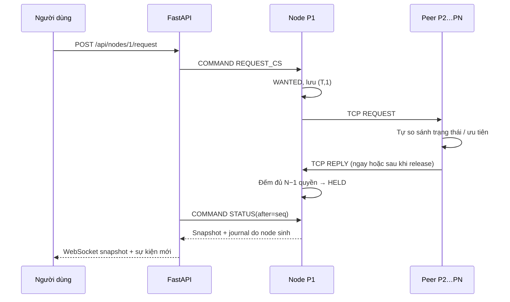

# Kiến trúc hệ thống

## Ranh giới trách nhiệm

`core/algorithm.py` là state machine đồng bộ thuần Python. Nó quản lý clock, state, cặp ưu tiên, request ID, tập quyền và REPLY hoãn. Phương thức trả về danh sách thông điệp cần gửi; không đọc database, không gọi API, không biết dashboard.

`network/node.py` chạy trong một OS process riêng. Mỗi node có TCP server, outbox FIFO, state lock, timer tự release và journal sự kiện. Network I/O diễn ra ngoài lock. Đang chờ quyền không làm node ngừng phục vụ REQUEST từ peer.

`services/simulation.py` quản lý subprocess local và gọi management STATUS của từng node mỗi khoảng 200 ms. Journal do node sinh, backend không suy diễn thông điệp protocol hoặc tạo log mẫu. Cursor `(boot_id, seq)` chống lặp, phát hiện node restart và báo khoảng trống nếu ring buffer bị xoay vòng. Refresh có lock riêng để polling và thao tác lifecycle không thu trùng sự kiện.

`main.py` cung cấp HTTP API, WebSocket và bản build static. `frontend/src` dùng React/SVG; animation minh họa sự kiện gửi quan sát được, không phải phép đo thời gian trên dây.

## Luồng giao tiếp

Mũi tên backend → node là lệnh của người dùng hoặc đọc trạng thái. Không có API `grant`, `lock` hoặc logic backend chọn node thắng.

## Lifecycle và lỗi

- Local start kiểm tra cổng trống, tạo session ID mới, ghi `.runtime/session.json`, spawn năm process bằng cùng `sys.executable` và cùng cấu hình.
- Chờ tất cả node trả STATUS trước khi công bố startup hoàn tất. Lỗi khởi động dọn các process đã tạo.
- Stop gửi SHUTDOWN; nếu process chưa thoát trong bốn giây thì kết thúc process do chính service sở hữu. Không tìm rồi kill process ngoài membership quản lý.
- Reset dừng toàn phiên trước khi sinh phiên mới; node cũ không được cấp quyền cho request phiên mới.
- Node mất kết nối monitor vẫn trao đổi protocol và tự chạy timer. Chế độ external cho phép restart observer mà không dừng các node.
- Thoát sạch local manager chủ động dừng các child để tránh bỏ lại tiến trình. Sau manager crash, kiểm tra PID/cổng; không âm thầm khởi tạo cluster thứ hai trên cổng cũ.
- Node lỗi giữa phiên không có cơ chế khôi phục quyền. UI báo offline, WANTED tiếp tục chờ.

## Quan sát và chứng minh

Snapshot của P1 và P2 được lấy ở những thời điểm khác nhau, có thể tạm nhìn thấy HELD cũ cùng HELD mới. Dashboard dùng nhãn thận trọng `NO_VIOLATION_OBSERVED` hoặc `UNCONFIRMED`; không dùng snapshot để ngăn/cấp quyền.

Kiểm thử đọc audit JSONL riêng từng node, sắp CS_ENTER/EXIT bằng `perf_counter_ns` có cùng nguồn trên một máy và kiểm tra tập owner. Với từng entry, đối chiếu các REPLY đã nhận có `seq` nhỏ hơn entry trong chính node đó. Bộ kiểm tra không tham gia vào protocol và không cấp khóa.

Node journal tối đa 4.000 sự kiện, backend 6.000, UI 1.500. Audit trên đĩa tùy chọn giữ lịch sử đầy đủ khi demo local. Khi tắt monitor quá lâu sẽ thấy OBSERVATION_GAP thay vì giả định đầy đủ log.
